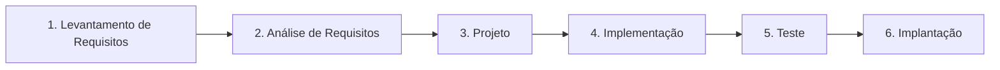
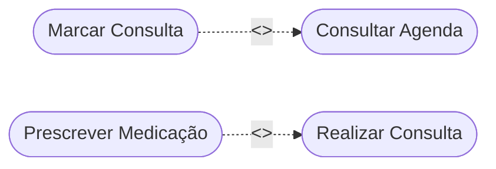

# Guia de Revisão para Prova (P1) — Análise e Projetos de Sistemas

**Instituição:** UNDB — Centro Universitário  
**Disciplina:** Análise e Projetos de Sistemas (ES04BN)  
**Docente:** Prof.ª Lady Silva  
**Base do Material:** `AnalisePSp1.pdf`

---

## Sumário Rápido
1. [Sistemas, Entrada–Processamento–Saída e Visão Sistêmica](#1-sistemas-e-visão-sistêmica)
2. [Processo de Análise de Sistemas e Requisitos](#2-processo-de-análise-de-sistemas-e-requisitos)
3. [Requisitos Funcionais (RF) vs. Requisitos Não Funcionais (RNF)](#3-requisitos-funcionais-vs-não-funcionais)
4. [Levantamento de Requisitos: Importância, Stakeholders e Técnicas](#4-levantamento-de-requisitos)
5. [UML — Unified Modeling Language](#5-uml--unified-modeling-language)
6. [Diagrama de Casos de Uso (`<<include>>` e `<<extend>>`)](#6-diagrama-de-casos-de-uso)
7. [Pegadinhas de Prova e Macetes de Memorização](#7-pegadinhas-de-prova-e-macetes)
8. [Simulado de Revisão com Gabarito Comentado](#8-simulado-de-revisão)

---

## 1. Sistemas e Visão Sistêmica

### O que é um Sistema?
> **Definição:** Um **sistema** é um conjunto organizado de elementos interdependentes — como pessoas, processos, dados, equipamentos e tecnologias — que interagem entre si para atingir um **objetivo comum**.

Todo sistema computacional opera segundo o fluxo fundamental:

```
[ Entrada (Input) ] ──▶ [ Processamento ] ──▶ [ Saída (Output) ]
```
- **Exemplo do material:** `leia(nome)` (entrada `"Carlos"`) → armazenamento/processamento na variável `Nome` → `escreva("Seu nome é", nome)` (saída `"Seu nome é Carlos"`).

### Visão Sistêmica
Ter visão sistêmica significa não olhar apenas para uma tela ou código isolado, mas para o todo:
1. **Entender o todo:** Análise holística para compreender o contexto.
2. **Identificar impactos e dependências:** Prever como mudanças em uma parte afetam outras partes.
3. **Evitar soluções isoladas:** Garantir que a solução se integre ao cenário existente.

### Sistemas no Contexto de TI
- **Apoiam processos de negócio:** Fundamentais para as operações empresariais.
- **Envolvem pessoas, tecnologia e dados:** Não é apenas software; é um **ecossistema**.
- **Não funcionam de forma isolada:** Interagem com outros sistemas e ambientes.

---

## 2. Processo de Análise de Sistemas e Requisitos

### Etapas do Processo de Análise de Sistemas


### O que é Análise de Requisitos?
É um ciclo contínuo composto por três ações centrais:
1. **Entender:** Identificar necessidades do negócio.
2. **Documentar:** Descrever funcionalidades e restrições.
3. **Validar:** Confirmar com os *stakeholders*.

E apoia-se em três frentes:
- **Identificar Stakeholders:** Todos que impactam ou são impactados pelo sistema.
- **Compreender Necessidades:** Ir além do óbvio, descobrir o que realmente importa.
- **Explorar Regras de Negócio:** Entender contexto, restrições e objetivos.

### O que é um Requisito? (Definições dos Autores)
- **Roger Pressman (2011):** *"Requisitos são descrições das funções e restrições de um sistema de software, que devem ser atendidas para satisfazer as necessidades do cliente."*
- **Marco Túlio Valente (2022):** *"Requisitos representam as necessidades do negócio e dos usuários, expressas de forma que permitam evoluir o sistema com foco em valor."*

### Hierarquia / Pirâmide de Requisitos
Do mais geral (alto nível) ao mais específico (detalhamento técnico):

| Nível | Camada | O que contém |
| :--- | :--- | :--- |
| **Topo** (Alto nível de generalização) | **Regra de Negócio** | Escopo do projeto, objetivos de negócio, solicitações do patrocinador |
| **Meio** | **Requisitos do Usuário** | Ambiente de uso, necessidades do usuário, processos do usuário |
| **Base** (Detalhamento específico) | **Requisitos de Sistema** | Requisito Funcional (RF) e Requisito Não Funcional (RNF) |

---

## 3. Requisitos Funcionais vs. Não Funcionais

Esta é uma das distinções mais cobradas em provas de Análise de Sistemas:

| Critério | Requisitos Funcionais (RF) | Requisitos Não Funcionais (RNF) |
| :--- | :--- | :--- |
| **Pergunta-chave** | **O QUÊ** o sistema deve fazer? | **COMO** o sistema deve se comportar? |
| **Foco** | Funcionalidades específicas e comportamento direto | Atributos de qualidade e restrições técnicas |
| **Ligação** | Ligados diretamente a ações/serviços do sistema | Não estão ligados a uma funcionalidade específica (transversais) |
| **Exemplos do material** | • Permitir login com e-mail e senha<br>• Cadastrar usuários<br>• Gerar relatórios<br>• Processar pagamentos<br>• Enviar notificações | • Responder em menos de 2 segundos (Tempo de resposta)<br>• Escalabilidade<br>• Segurança de dados<br>• Compatibilidade com navegadores |

---

## 4. Levantamento de Requisitos

### Por que o Levantamento é uma Fase Crítica?
> *"Não é sobre construir rápido, é sobre construir o certo."*

1. **Problemas no escopo:** Entendimento equivocado do escopo gera uma solução errada.
2. **Problemas de volatilidade:** Requisitos mudam com o tempo; por isso o levantamento precisa ser organizado.
3. **Custos exponenciais:** Correções tardias custam **até 100x mais** quando decorrem de erros em especificações.

### Partes Interessadas no Documento de Requisitos
Cada papel usa o Documento de Requisitos com um objetivo:
- **Gerente de Projetos:** Para planejar.
- **Desenvolvedor:** Para entender e desenvolver.
- **Dono do Produto (*Product Owner*):** Para manter.
- **Testador / QA:** Para testar.

### Técnicas de Levantamento

| Técnicas Clássicas | Técnicas Modernas |
| :--- | :--- |
| **Entrevistas:** Conversas estruturadas com *stakeholders* | **Workshops colaborativos:** Co-criação com múltiplos *stakeholders* |
| **Questionários:** Coleta de informações em escala | **Design Thinking:** Requisitos na perspectiva do usuário |
| **Observação:** Acompanhar processos reais em campo | **User Stories:** Empatia e ideação centrada no usuário |

---

## 5. UML — Unified Modeling Language

### Conceito Central
> *"UML não é programa. UML pensa o sistema antes do código."*

- **Linguagem visual padronizada** para modelagem de sistemas orientados a objetos.
- **Independente de linguagem de programação** (serve para Java, Python, C#, etc.).
- **Baseada em Orientação a Objetos.**
- **Utilizada em análise e projeto de sistemas** para transformar conceitos abstratos em diagramas compreensíveis.

### Principal Objetivo e Benefícios
- **Principal objetivo:** Modelar sistemas com precisão e clareza antes da implementação:
  1. **Reduzir ambiguidades:** Evita interpretações divergentes entre desenvolvedores e *stakeholders*.
  2. **Melhorar comunicação:** Cria uma linguagem comum para equipes técnicas e não técnicas.
  3. **Documentar soluções:** Registra decisões arquiteturais e facilita manutenção futura.
- **Benefícios práticos:**
  - **Padronização:** Linguagem universal entre profissionais de diferentes áreas/culturas.
  - **Comunicação Clara:** Ponte entre áreas técnicas e não técnicas.
  - **Redução de Retrabalho:** Detecta falhas na fase de projeto, economizando tempo e recursos.
  - **Documentação Viva:** Base estruturada para manutenção, evolução e engenharia reversa.

### Classificação dos Diagramas UML

| Categoria | O que representa | Pergunta que responde | Exemplos citados |
| :--- | :--- | :--- | :--- |
| **Diagramas Estruturais** | Estrutura estática do sistema (classes, componentes, pacotes, objetos) | **"De que o sistema é feito?"** | Diagrama de Classe |
| **Diagramas Comportamentais** | Comportamento dinâmico (casos de uso, atividades, estados) | **"O que o sistema faz?"** | Diagrama de Caso de Uso |
| **Diagramas de Interação** | Subgrupo dos comportamentais que detalha troca de mensagens entre objetos | Como os objetos trocam mensagens ao longo do tempo/estrutura? | Diagrama de Sequência, Comunicação, Temporização |

---

## 6. Diagrama de Casos de Uso

### O que é e Para que Serve?
Modela o sistema pela **perspectiva do usuário** — **o que ele faz, não como é implementado**. Funciona como ponte visual entre requisitos, equipe e cliente.

**Por que usar?**
- Definir e validar requisitos.
- Facilitar a comunicação com clientes.
- Sugerir cenários para casos de teste.

### Elementos Básicos (Responde: *Quem interage? O que faz? Qual sistema?*)
1. **Ator** *(boneco palito, fora do retângulo)*: Tipo de usuário, pessoa ou sistema externo que interage com o sistema.
2. **Caso de Uso** *(elipse/oval, dentro do retângulo)*: Tarefa ou funcionalidade oferecida pelo sistema para atender a um objetivo do ator.
3. **Sistema** *(retângulo)*: Delimita a fronteira do que está sendo modelado.
4. **Comunicação** *(linha contínua)*: Liga um ator a um caso de uso, indicando interação.

- **Cenário:** Sequência de eventos que acontece quando um ator interage com o sistema (ex.: na clínica: *1. Solicitação → 2. Consulta à agenda → 3. Marcação → 4. Atendimento*).

### Relações entre Casos de Uso: `<<include>>` vs. `<<extend>>`

| Relação | Significado | Regra | Direção da Seta (Pontilhada) | Exemplo do Material |
| :--- | :--- | :--- | :--- | :--- |
| **`<<include>>`** | **Uso obrigatório** | O caso base **sempre** precisa chamar o outro para concluir sua funcionalidade (*sempre necessário*). | Do **Caso Base ──▶ Caso Incluído** | `Marcar Consulta` `--<<include>>-->` `Consultar Agenda` |
| **`<<extend>>`** | **Extensão opcional** | O caso estendido acrescenta passos ao caso base **apenas em uma situação específica** (*pode acontecer*). | Do **Caso Estendido ──▶ Caso Base** | `Prescrever Medicação` `--<<extend>>-->` `Realizar Consulta` |



> **Regra prática:** Use o diagrama para validar se o sistema está claro, se faltam funcionalidades e quais cenários podem gerar casos de teste.

---

## 7. Pegadinhas de Prova e Macetes

1. **Seta do `<<include>>` vs. `<<extend>>`:**
   - No `<<include>>`, a seta **sai** do caso principal para o obrigatório (`A --<<include>>--> B`).
   - No `<<extend>>`, a seta **entra** no caso principal, saindo do opcional (`Opcional --<<extend>>--> Principal`).
   - *Macete:* **IN**clude vai para **DENTRO** do que é preciso fazer; **EX**tend vem de **FORA** para estender o principal.

2. **Diagramas de Interação são Comportamentais!**
   - Se a questão perguntar a qual grupo pertence o **Diagrama de Sequência**, lembre-se: ele é um **Diagrama de Interação**, que é um **subgrupo dos Diagramas Comportamentais**.

3. **Ator não é só humano:**
   - Um "Sistema de Autenticação" ou "Gateway de Pagamento" também pode ser um **Ator** (sistema externo que interage com o sistema modelado).

4. **UML não é linguagem de programação e não mostra "como" codificar:**
   - Caso de Uso mostra **o que** o sistema faz sob a visão do usuário, nunca a implementação interna.

5. **Custo de correção tardia:**
   - Erros de especificação no levantamento de requisitos custam **até 100x mais** se descobertos tarde.

6. **RF vs. RNF em enunciados:**
   - Apareceu verbo de ação/funcionalidade para o usuário ("gerar relatório", "fazer login", "processar pagamento") → **Requisito Funcional**.
   - Apareceu métrica, desempenho, segurança, compatibilidade, restrição ("em menos de 2s", "criptografado", "compatível com Chrome") → **Requisito Não Funcional**.

---

## 8. Simulado de Revisão

### Questões Objetivas

**1. Sobre o conceito de sistema e visão sistêmica no contexto de TI, assinale a alternativa CORRETA:**
a) Um sistema de TI resume-se exclusivamente ao código-fonte do software desenvolvido.  
b) Sistemas corporativos funcionam de forma isolada para evitar dependências entre áreas.  
c) A visão sistêmica busca entender o todo, identificar impactos e dependências, evitando soluções isoladas.  
d) O fluxo básico de um sistema segue a ordem: Processamento → Entrada → Saída.

**2. Qual técnica de levantamento de requisitos é classificada como "Técnica Moderna" no material da disciplina?**
a) Questionários  
b) Observação em campo  
c) Entrevistas estruturadas  
d) Design Thinking  

**3. "O sistema deve responder às consultas de usuários em menos de 2 segundos e ser compatível com os principais navegadores." Essa afirmação descreve:**
a) Uma Regra de Negócio  
b) Dois Requisitos Funcionais  
c) Dois Requisitos Não Funcionais  
d) Um Caso de Uso com relação `<<include>>`  

**4. Na classificação dos diagramas UML, qual categoria responde à pergunta *"De que o sistema é feito?"* e tem como exemplo o Diagrama de Classe?**
a) Diagramas Comportamentais  
b) Diagramas Estruturais  
c) Diagramas de Interação  
d) Diagramas de Casos de Uso  

**5. Em um Diagrama de Casos de Uso de uma clínica médica, sempre que a secretária realiza "Marcar Consulta", o sistema obrigatoriamente executa "Consultar Agenda". Por outro lado, durante "Realizar Consulta", o médico pode, em algumas situações, "Solicitar Exames". As relações corretas são, respectivamente:**
a) `<<extend>>` e `<<include>>`  
b) `<<include>>` e `<<include>>`  
c) `<<include>>` e `<<extend>>`  
d) Comunicação e `<<extend>>`  

---

### Questões Discursivas (Estilo Prova)

**6. Explique por que o Levantamento de Requisitos é considerado uma fase crítica no desenvolvimento de sistemas, citando os três principais problemas/riscos apresentados no material.**

**7. Diferencie Requisito Funcional de Requisito Não Funcional e dê 2 exemplos de cada um aplicados a um "Sistema de Reserva de Sala de Estudo".**

**8. Qual é a diferença conceitual e prática entre os relacionamentos `<<include>>` e `<<extend>>` em um Diagrama de Casos de Uso? Indique também para onde aponta a seta em cada caso.**

---

### Gabarito Comentado

- **Questão 1 — C:** A visão sistêmica envolve análise holística (entender o todo), identificar impactos/dependências e evitar soluções isoladas. (A) é falsa porque sistema envolve pessoas, processos, dados e tecnologia; (B) é falsa porque sistemas interagem entre si; (D) inverte o fluxo Entrada–Processamento–Saída.
- **Questão 2 — D:** Entrevistas, Questionários e Observação são *Técnicas Clássicas*. Workshops colaborativos, Design Thinking e User Stories são *Técnicas Modernas*.
- **Questão 3 — C:** Tempo de resposta (< 2 segundos) e compatibilidade com navegadores são atributos de qualidade/restrições técnicas (como o sistema se comporta), caracterizando Requisitos Não Funcionais.
- **Questão 4 — B:** Diagramas Estruturais representam a estrutura estática e respondem *"De que o sistema é feito?"* (ex.: Diagrama de Classe). Comportamentais respondem *"O que o sistema faz?"*.
- **Questão 5 — C:** "Consultar Agenda" é obrigatório sempre que "Marcar Consulta" ocorre → `<<include>>`. "Solicitar Exames" é opcional/condicional durante "Realizar Consulta" → `<<extend>>`.

- **Questão 6 (Resposta esperada):** É crítica porque define o que deve ser construído ("construir o certo"). Os três riscos são: (1) *Problemas no escopo* (entendimento errado gera solução errada); (2) *Problemas de volatilidade* (requisitos mudam com o tempo e exigem organização); (3) *Custos exponenciais* (correções tardias de erros de especificação custam até 100x mais).
- **Questão 7 (Resposta esperada):** *Requisito Funcional* define **o que** o sistema faz (ex.: 1. Permitir que o aluno reserve uma sala por horário; 2. Permitir cancelar reserva). *Requisito Não Funcional* define **como** o sistema se comporta, focando em qualidade e restrições (ex.: 1. Carregar a grade de horários em menos de 2 segundos; 2. Garantir autenticação segura dos dados do aluno).
- **Questão 8 (Resposta esperada):** `<<include>>` indica dependência **obrigatória** (sempre necessária) e a seta pontilhada aponta do caso base para o caso incluído. `<<extend>>` indica extensão **opcional** (ocorre apenas em situações específicas) e a seta pontilhada aponta do caso estendido para o caso base.
